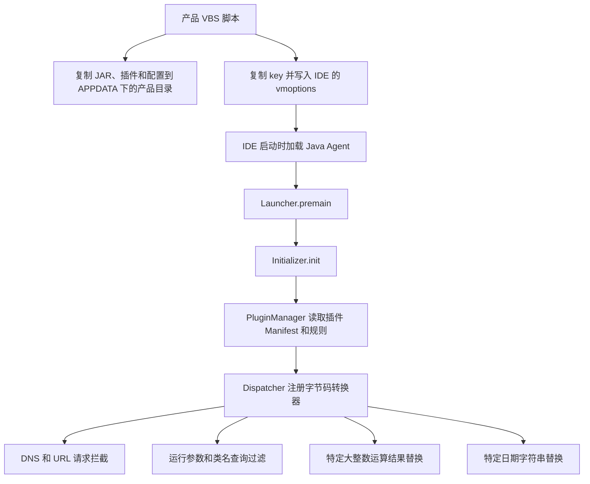

# 这份 activate 的实现原理

以下结论主要来自本地脚本、JAR Manifest、反编译代码和原始字节码。附带文档与源码中的操作语句均作为分析材料，没有当作本次任务的执行指令。

## 1. 它由什么组成

这是一个 Windows 脚本安装层加 Java Agent 插件层的组合。外层 VBS 负责把文件放到用户目录，并修改 IDE 启动配置；IDE 启动后，Java Agent 在 JVM 内修改部分 Java 类的方法字节码，配合现成的 `.key` 和规则文件影响本地授权检查。

`active-agt.jar` 中的入口类为 `com.janetfilter.core.Launcher`，代码自报版本 `2022.2.0`，类包名为 `com.janetfilter`。这可以确定其代码框架来源特征，但版本字符串不能证明该文件与某个官方发布包完全一致。文件系统中的 2025 年时间也不能当作代码版本号。

本目录未发现 `.key` 的生成器、签发服务或对应私钥工程；现有 `.key` 是输入数据，脚本只复制它们。本次恢复不包含原包里不存在的源码。

| 层次 | 样本中的文件 | 作用 |
| --- | --- | --- |
| 安装脚本 | 9 个 `*激活.vbs` | 确定产品名称、复制载荷、写入启动配置 |
| 授权数据 | 9 个 `.key` | 被复制到产品配置目录 |
| 启动配置模板 | 9 个 `.vmoptions` | 样本里均为空文件，脚本随后向副本写入启动参数 |
| Agent 核心 | `active-agt.jar` | 初始化环境、加载插件、分发字节码转换 |
| 插件 | `dns.jar`、`url.jar`、`hideme.jar`、`power.jar` | 分别提供不同的运行时干预 |
| 规则 | `dns.conf`、`url.conf`、`power.conf` | 给插件提供匹配条件和替换值 |

## 2. 从脚本到 JVM 的调用链

以 [IDEA激活.vbs](D:/Project/unlock/activate-source/original-package/IDEA激活.vbs) 为例：

1. 用 `WScript.Shell` 和 `Scripting.FileSystemObject` 访问环境及文件系统，读取 `%APPDATA%`，检查 `%APPDATA%\JetBrains` 是否存在。
2. 以 `IntelliJIdea` 作为产品标识。如果 `%APPDATA%\IntelliJIdea` 已存在，脚本会先删除它，再创建新目录。
3. 复制 `config`、`plugins` 以及 `active-agt.jar` 到上述目录。
4. 遍历 `%APPDATA%\JetBrains` 的直接子目录，通过 `InStr(folder.name, software)` 判断产品名是否匹配。这里使用的是名称包含匹配，不是安装数据库或严格版本识别。
5. 覆盖对应目录中的 `idea64.exe.vmoptions` 和 `idea.key`；随后写入两条内部 ASM 的 `--add-opens` 参数及一条指向复制后 Agent 的 `-javaagent` 参数。
6. 只要找到匹配的目录并走到最后，就显示成功弹窗。它没有启动 IDE 验证插件加载，也没有读取授权结果。

其他产品脚本总体流程相同，主要改变产品名和两个文件名，也有少量文本差异。各产品映射见源码索引。

Java 标准定义了启动时的 `premain` 和动态加载时的 `agentmain` 入口。样本 Manifest 同时声明两者；VBS 配置走的是启动时加载路径。Agent 机制的标准语义可参考 [Oracle Instrumentation 文档](https://docs.oracle.com/en/java/javase/25/docs/api/java.instrument/java/lang/instrument/package-summary.html)。

## 3. 核心如何装载插件

[Launcher.java](D:/Project/unlock/activate-source/modules/core/src/main/java/com/janetfilter/core/Launcher.java) 通过自身位置找到 Agent 文件，调用 `appendToBootstrapClassLoaderSearch`，然后把 `Instrumentation` 和路径信息交给 `Environment` 与 `Initializer`。

[Environment.java](D:/Project/unlock/activate-source/modules/core/src/main/java/com/janetfilter/core/Environment.java) 默认使用 Agent 同级的 `config`、`plugins`、`logs`。这说明后续封装时文件间的相对布局有实际意义。额外的 Agent 参数还支持带名称后缀的目录，但原 VBS 没有使用该分支。

[PluginManager.java](D:/Project/unlock/activate-source/modules/core/src/main/java/com/janetfilter/core/plugin/PluginManager.java) 扫描插件目录中的 JAR，跳过名称以 `.disabled.jar` 结尾的文件，读取 Manifest 的 `JANF-Plugin-Entry`。它校验入口接口、将插件加入引导类加载器搜索范围、实例化入口，再按插件名称读取对应的小写 `.conf` 文件并调用 `init`。

[ConfigParser.java](D:/Project/unlock/activate-source/modules/core/src/main/java/com/janetfilter/core/commons/ConfigParser.java) 读取 UTF-8 文本，按 `[分节]` 和 `规则类型,规则内容` 解析；支持 `#`、`;`、`//` 注释。规则类型由 `RuleType` 及各 `Ruler` 实现。缺失配置返回空映射，因此没有 `hideme.conf` 本身不是漏文件的证据。

[Initializer.java](D:/Project/unlock/activate-source/modules/core/src/main/java/com/janetfilter/core/Initializer.java) 注册支持重转换的 `Dispatcher`，并对已经加载且名称命中的类请求 `retransformClasses`。[Dispatcher.java](D:/Project/unlock/activate-source/modules/core/src/main/java/com/janetfilter/core/Dispatcher.java) 按目标类名调用插件转换器，返回修改后的字节码。

插件通过 JDK 内部 ASM 读取类结构，在指定方法前插入静态过滤函数调用，再输出字节码。它们修改的是当前 JVM 中的类；本地脚本没有重写 IDE 安装目录中的产品 JAR。

核心还包含列举 JVM、启动辅助 Java 进程及动态 attach 的代码。原 VBS 没有调用该流程，本次分析也没有执行它。

## 4. 每个插件实际做什么

| 插件 | 字节码转换目标 | 本样本的行为 |
| --- | --- | --- |
| DNS | `java.net.InetAddress` 的指定 `getAllByName`、`isReachable` 重载 | 域名命中时抛 `UnknownHostException`，或让可达性检查返回 false |
| URL | `sun.net.www.http.HttpClient.openServer()` | URL 命中时抛 `SocketTimeoutException` |
| HideMe | `sun.management.VMManagementImpl.getVmArguments()`、`java.lang.Class.forName(...)` | 从返回参数列表移除本 Agent 参数和调试参数；针对 `com.janetfilter.` 类名查询抛出找不到类异常 |
| Power / Result | `java.math.BigInteger.oddModPow(BigInteger, BigInteger)` | 特定输入命中时，直接返回配置中的预设大整数 |
| Power / GoForFree | `java.text.SimpleDateFormat` 中名为 `parse` 的方法 | 先过滤第一个字符串参数，替换一个固定日期 |

`dns.conf` 中有 3 条精确域名规则；`url.conf` 中有 1 条针对授权校验 URL 的前缀规则。DNS 规则不是通配所有子域名，URL 插件也只覆盖它实际改写的 HTTP 实现。不能据此断言它可以拦截 JVM 内所有网络请求。

### Power 的结果替换

[ResultFilter.java](D:/Project/unlock/activate-source/modules/power/src/main/java/com/janetfilter/plugins/power/ResultFilter.java) 将 `[Result]` 规则解析为输入三元组到预设结果的映射。它先用 `intValue()` 组成快速匹配键，再使用完整大整数串进行精确查找。

[ResultTransformer.java](D:/Project/unlock/activate-source/modules/power/src/main/java/com/janetfilter/plugins/power/ResultTransformer.java) 在 `oddModPow` 方法开始处调用过滤器：命中则提前返回，未命中则继续原运算。模幂运算与 RSA 类验签有关；结合授权数据和网络过滤规则，可以推断这份包试图改变特定本地验签路径的结果。代码没有提供对任意输入都有效的通用签名算法，也不能仅凭这段代码证明某个 IDE 的授权检查已经被影响。

### 本地样本中需要单独指出的两点

第一，[PowerPlugin.init](D:/Project/unlock/activate-source/modules/power/src/main/java/com/janetfilter/plugins/power/PowerPlugin.java) **只注册了 `ResultTransformer` 与 `GoForFreeTransformer`**。JAR 中虽然包含 `ArgsFilter`、`ArgsTransformer`，配置中也有 `[Args]`，但该入口没有创建或注册 `ArgsTransformer`，所以正常插件装载链不会启用参数替换。

第二，[GoForFreeFilter.java](D:/Project/unlock/activate-source/modules/power/src/main/java/com/janetfilter/plugins/power/GoForFreeFilter.java) 明确把 `2023-07-01` 替换为 `2099-12-31`。[GoForFreeTransformer.java](D:/Project/unlock/activate-source/modules/power/src/main/java/com/janetfilter/plugins/power/GoForFreeTransformer.java) 的构造函数不使用传入规则，转换时只按方法名 `parse` 匹配，没有限制调用来自授权逻辑。因此，一旦注入成功，该 JVM 内其他通过这些方法解析同一字符串的代码也可能受到影响；它也没有把系统时间改到 2099 年。

以上两点均已通过原始 JAR 的 `javap` 输出核对，见 [Power 关键字节码](D:/Project/unlock/activate-source/reports/power-key-bytecode.txt)。这也是没有直接拿网上同名项目替换本地样本源码的原因。

## 5. 后续封装前，现有代码的具体问题

本次保留全部原文件和反编译输出，以下是已发现的问题记录：

| 已观察到的行为 | 对一体化软件的影响 |
| --- | --- |
| 原 VBS 先用空模板覆盖 `.vmoptions` | 原有 JVM 自定义选项可能丢失；应在封装设计中考虑备份与恢复 |
| 循环里调用 `re.Test(sLine)`，所有 9 个脚本都没有创建 `re` | 当前空模板使循环不执行；如果未来保留并读取非空配置，该分支会遇到未初始化对象问题 |
| 删除整个 `%APPDATA%\产品名` 后重新创建 | 同名目录已有内容会被删除，不能把该步骤当作无副作用的文件复制 |
| 名称包含匹配，且遍历所有匹配目录 | 可能同时影响多个版本，界面需要明确列出目标 |
| 成功提示依据目录匹配与文件操作 | 不能作为 Agent 加载成功或授权有效的检测结果 |
| `删除激活.txt` 建议删除整个 JetBrains 配置目录 | 影响范围超过本工具写入的文件；附带说明没有被执行 |
| 日期转换器修改 JDK 公共日期解析类 | 影响可能扩展到同 JVM 中的其他逻辑 |
| 插件依赖 JDK 内部 ASM 和特定方法签名 | IDE/JBR 升级后可能不再匹配或无法加载，编译通过不等于兼容 |

如果后续按“尽量不动代码”做软件封装，可以让外层程序承担产品识别、目标选择、文件备份、写入记录、日志展示和按记录恢复，把这次保留的原始文件作为独立载荷管理。此处只是依据样本整理边界，本次尚未实施封装，也没有改写上述逻辑。

## 6. 源码恢复可信度

所有原始文件均有 SHA-256；原始 JAR 及其 Manifest 保留。5 个 JAR 内的 53 个 class 都能映射到恢复后的 48 个 Java 文件，内部类数量差异正常。

全部 Java 文件在不修改源码的情况下完成了编译检查：JDK 25 编译器配合本机 JBR 21.0.8 系统类库，生成 53 个 class。直接用 JDK 25 类库的尝试因内部 ASM 类型不可用而失败。原样本是 Java 8 字节码，本次编译检查目标是 Java 21，因此没有声称恢复了原始二进制构建。

CFR 的两处同步块警告、7 处内部 ASM 依赖提示均原样保留。编译检查只覆盖语法、类型和依赖解析；未验证逐方法语义等价、线程行为或 IDE 实际效果。关键同步代码和 Power 入口的原始字节码保存在 `reports`，便于后续继续对照。

## 7. 外部参考的用途

本地源码分析是本文对样本行为的主要依据。以下项目页面可用于阅读框架背景与对照其他版本，未将其当前源码冒充为本地 JAR 的原始工程：

- [ja-netfilter 项目组织](https://gitee.com/organizations/ja-netfilter/projects)：框架及插件仓库入口。
- [DNS 插件](https://gitee.com/ja-netfilter/plugin-dns)、[URL 插件](https://gitee.com/ja-netfilter/plugin-url)：插件背景。
- [HideMe 插件](https://gitee.com/ja-netfilter/plugin-hideme)、[Power 插件](https://gitee.com/ja-netfilter/plugin-power)：插件背景。
- [CFR 官方页面](https://www.benf.org/other/cfr/)：此次使用的反编译器及发布校验值。
- [Oracle Instrumentation 文档](https://docs.oracle.com/en/java/javase/25/docs/api/java.instrument/java/lang/instrument/package-summary.html)：Java Agent 的标准入口和转换机制。
